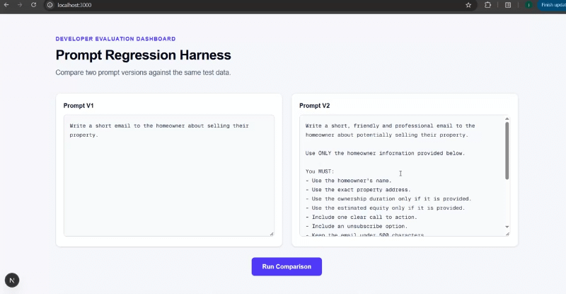
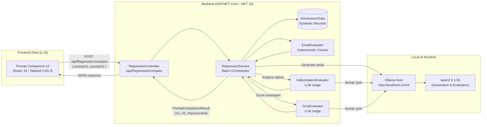

# Prompt Regression Harness

A tool for evaluating how prompt changes impact LLM output quality across repeatable test data.

Prompt Regression Harness treats prompt engineering as a software regression testing problem. Instead of casually eyeballing a few outputs in a playground, the harness runs candidate prompt versions (Prompt V1 vs. Prompt V2) against a fixed synthetic homeowner dataset, generates outreach emails via a local LLM hosted in Ollama, evaluates each response through a hybrid scoring pipeline, and surfaces regressions and score deltas in a side-by-side dashboard.

The focus is on **AI reliability and evaluation**—verifying that prompt improvements intended to fix one behavior do not quietly break compliance, length constraints, or factual consistency.

---

## Demo



*The demo above illustrates editing two prompt variations, executing the test suite against the synthetic homeowner dataset, and comparing pass rates, and individual check results side by side.*

---

## Why I built this

When iterating on prompts for LLM applications, fixing one problem often introduces another. Adding instructions to sound more natural might cause the model to drop mandatory compliance notices. Tightening word limits might cause it to hallucinate missing data to fill space.

Manually spot-checking outputs in an ad-hoc chat interface does not scale and easily misses subtle regressions. In traditional software engineering, modifying code is backed by automated regression test suites. I built this harness to apply the same discipline to prompt development:

```text
Prompt change
     ↓
Run against repeatable test data
     ↓
Generate outputs
     ↓
Evaluate outputs
     ↓
Compare V1 vs V2
     ↓
Identify regressions
```

By benchmarking outputs across a deterministic test set with explicit pass/fail checks, developers can make prompt edits with measurable confidence rather than guesswork.

---

## How it works

The evaluation workflow follows a structured sequence:

```text
User Prompts (V1 & V2)
        │
        ▼
[ Homeowner Dataset ] ──────────► [ Ollama (qwen2.5:1.5b) ] ──────────► Generated Emails
(Sarah Kim, John Smith,                (http://localhost:11434)
 Michael O'Connor)                                                               │
                                                                                ▼
                                                                     [ Evaluation Pipeline ]
                                                                       ├─ Deterministic Rules
                                                                       └─ LLM Judges (JSON)
                                                                                │
                                                                                ▼
[ Next.js Comparison UI ] ◄────────────────────────────────────────── Batch Comparison & Deltas
```

1. **Prompt definition**: The user inputs or edits Prompt V1 (baseline) and Prompt V2 (candidate) in the web UI.
2. **Fixed dataset input**: The ASP.NET Core backend feeds both prompts into the same synthetic homeowner records (`Sarah Kim`, `John Smith`, and `Michael O'Connor`), each with distinct properties (some with equity, some without ownership tenure).
3. **Local generation**: The backend forwards each prompt and homeowner context to a local Ollama instance running `qwen2.5:1.5b`.
4. **Deterministic evaluation**: The generated email is checked against eight objective rules:
   - **Homeowner name**: Verifies the homeowner's name is referenced.
   - **Physical address**: Verifies the exact property address is present.
   - **Years owned**: Checks whether ownership tenure is accurately cited (or safely omitted if null).
   - **Estimated equity**: Verifies the dollar equity amount if provided, and verifies no currency symbol is hallucinated when unprovided.
   - **Unsubscribe line**: Ensures required opt-out language (`"unsubscribe"`) is included.
   - **Banned phrases**: Flags disallowed sales words (such as `"act now"` or `"guaranteed"`).
   - **Call to action**: Confirms the presence of action-oriented phrases (`"reply"`, `"call"`, `"contact"`, etc.).
   - **Email length**: Enforces a strict 500-character ceiling.
5. **LLM-as-a-judge evaluation**: Two specialized LLM evaluators run structured JSON queries against the model:
   - **Hallucination evaluator**: Compares the email against source record facts. Every factual statement must be grounded in provided data. If the model invents loan figures, buyers, or facts, the test fails.
   - **Tone and spam evaluator**: Scores the output on Tone (1–10, minimum pass: 6) and Spamminess (1–10, maximum pass: 4).
6. **Aggregation and reporting**: Results are aggregated into total tests, pass counts, fail counts, pass percentages, and delta improvements.
7. **Side-by-side inspection**: The frontend renders summary cards and expandable cards for each test record, showing the raw generated email and green/red status markers for each check.

---

## Hybrid evaluation approach

Relying entirely on string matching fails to capture semantic problems like subtle factual hallucinations or pushy language. Conversely, relying entirely on an LLM judge makes a test suite slower, more expensive, and susceptible to the judge's own non-determinism.

This harness employs a hybrid evaluation strategy:

| Evaluation Type | Implementation | Target Requirements | Why |
| :--- | :--- | :--- | :--- |
| **Deterministic Checks** | C# string & regex logic (`EmailEvaluator`) | Name, address, numbers, unsubscribe, banned words, character length | Objective, immediate, 100% reproducible, zero token overhead |
| **LLM-as-a-Judge** | Structured JSON prompts (`HallucinationEvaluator`, `ToneEvaluator`) | Unsupported claims, invented details, professional tone, spam score | Handles natural language semantics that string matching cannot parse |

Grounding objective constraints in deterministic code reserves LLM evaluation for qualitative assessments, striking a pragmatic balance between reproducibility and semantic coverage.

---

## Ollama and local LLM usage

All language model inference is hosted locally via [Ollama](https://ollama.com/), eliminating external API keys, service fees, and third-party data transmission.

- **Configured Model**: `qwen2.5:1.5b`
- **Host Endpoint**: `http://localhost:11434`
- **Execution**: The backend communicates directly with Ollama's `/api/generate` endpoint, using standard text generation for outreach emails and strict JSON mode (`format: "json"`) for evaluators.

Using a local model ensures:
- **Data privacy**: Test data and homeowner profiles never leave the local machine.
- **Zero API costs**: Developers can run hundreds of regression sweeps without incurring token billing.
- **Provider neutrality**: The architecture decouples the evaluation harness from specific commercial cloud APIs.

*Note: Ollama acts as the runtime host and serving engine; `qwen2.5:1.5b` is the actual underlying model.*

---

## Model limitations

The quality of both email generation and LLM-as-a-judge evaluation depends on the configured model. The harness currently uses `qwen2.5:1.5b`, which is a lightweight 1.5-billion parameter model chosen for speed and local accessibility.

Because of its compact parameter size, `qwen2.5:1.5b` can:
- Occasionally overlook complex, multi-sentence negative prompt constraints.
- Invent unsupported background details or misinterpret omitted fields.
- Show run-to-run variability.
- Misclassify hallucinations or assign subjective tone/spam scores with imperfect fidelity.
- Occasionally output poorly formatted JSON that falls back to parse-failure handling.

These limitations are not disguised—in fact, they make this small model an ideal demonstration vehicle for why prompt regression testing is necessary. A prompt that is too vague (`"Write an email to sell their home"`) will fail consistently, whereas a structured prompt with explicit negative bounds and formatting constraints shows measurable pass-rate gains.

> [!NOTE]
> Pass rates reported by the harness represent performance against this project's specific dataset, prompt instructions, evaluator prompts, and model. They should not be interpreted as absolute benchmarks of general LLM capability. Running the harness against larger models (e.g., `qwen2.5:7b` or `llama3.1:8b`) will shift baseline scores.

---

## Architecture



### Technology stack

- **Frontend**: Next.js 16 (App Router), React 19, TypeScript 5, Tailwind CSS 4
- **Backend**: ASP.NET Core (.NET 10), C# 13, Microsoft OpenAPI
- **Model Runtime**: Ollama serving `qwen2.5:1.5b`
- **HTTP Client**: Typed `HttpClient` configured for local Ollama endpoints with CORS support for `http://localhost:3000`

---

## Example regression

Below is an illustrative comparison demonstrating how structured prompt engineering improves compliance across the test suite:

```text
Prompt V1 (Minimal instruction)
Prompt: "Write a short email to the homeowner about selling their property."
   ↓
Pass rate: ~33%
Common failures:
- Missing mandatory unsubscribe disclaimer
- Exceeded 500-character length limit
- Hallucinated market pricing / prospective buyers

Prompt V2 (Constrained instruction)
Prompt: "Write a short, friendly and professional email... Use ONLY provided info...
        Must include unsubscribe, under 500 characters, no invented details..."
   ↓
Pass rate: ~67%
Common improvements:
- Strict length adherence
- Unsubscribe disclaimer present
- Specific homeowner name and address referenced accurately

Net improvement: +34 percentage points
```

*Note: The figures above are illustrative representations of typical prompt optimization deltas across the test set.*

The key benefit is granular diagnostic visibility: developers can see exactly which check flipped from failed to passed between prompt iterations.

---

## Running locally

### Prerequisites

- [.NET 10 SDK](https://dotnet.microsoft.com/download)
- [Node.js](https://nodejs.org/) (v20+ recommended) and `npm`
- [Ollama](https://ollama.com/) installed and running

### 1. Set up Ollama

Ensure Ollama is running, then pull the configured model:

```bash
ollama pull qwen2.5:1.5b
```

Ollama will serve the model locally on `http://localhost:11434`.

### 2. Start the ASP.NET Core Backend

Navigate to the API project directory and run the server:

```bash
cd Backend/PromptRegression.Api
dotnet run
```

By default, the backend launches on:
- `http://localhost:5074`

Swagger / OpenAPI documentation is mapped in development mode.

### 3. Start the Next.js Frontend

In a separate terminal, navigate to the frontend directory:

```bash
cd Frontend/prompt-regression-ui
```

Verify that `.env.local` contains the backend URL:

```env
NEXT_PUBLIC_API_URL=http://localhost:5074
```

Install dependencies and start the development server:

```bash
npm install
npm run dev
```

Open [http://localhost:3000](http://localhost:3000) in your browser.

---

## API

The backend exposes three REST endpoints under the `/api/Regression` route:

### `POST /api/Regression/run`
Executes generation and evaluation for a single homeowner record and prompt.
- **Request**: `{ "homeowner": { "id": 1, "name": "...", "address": "...", ... }, "prompt": "..." }`
- **Response**: `EvaluationResult` containing generated email, individual check results, and an overall boolean `passed` flag.

### `POST /api/Regression/run-batch`
Executes regression testing across all synthetic records in `HomeownerData` for a single prompt.
- **Request**: `{ "prompt": "..." }`
- **Response**: `BatchRegressionResult` containing `totalTests`, `passedTests`, `failedTests`, `passRate`, and the list of `EvaluationResult` objects.

### `POST /api/Regression/compare`
The primary endpoint used by the frontend dashboard. Runs batch regressions for both Prompt V1 and Prompt V2 and calculates the net score delta.
- **Request**: `{ "promptV1": "...", "promptV2": "..." }`
- **Response**: `PromptComparisonResult` containing `v1` (BatchRegressionResult), `v2` (BatchRegressionResult), and `improvement` (percentage point difference).

---

## Project structure

```text
PromptRegressionHarness/
├── Backend/
│   └── PromptRegression.Api/
│       ├── Controllers/
│       │   └── RegressionController.cs      # API endpoints (run, run-batch, compare)
│       ├── Data/
│       │   └── HomeownerData.cs             # Synthetic homeowner test dataset
│       ├── Models/
│       │   ├── BatchRegressionRequest.cs
│       │   ├── BatchRegressionResult.cs
│       │   ├── CheckResult.cs
│       │   ├── EvaluationResult.cs
│       │   ├── HallucinationResult.cs
│       │   ├── Homeowner.cs
│       │   ├── PromptComparisonRequest.cs
│       │   ├── PromptComparisonResult.cs
│       │   ├── RegressionRequest.cs
│       │   └── ToneEvaluationResult.cs
│       ├── Properties/
│       │   └── launchSettings.json          # Dev port configuration (5074)
│       ├── Services/
│       │   ├── EmailEvaluator.cs            # Deterministic string/regex checks
│       │   ├── HallucinationEvaluator.cs    # LLM-as-a-judge factual consistency
│       │   ├── ILlmService.cs               # LLM abstraction contract
│       │   ├── OllamaLlmService.cs          # Ollama HTTP API implementation
│       │   ├── RegressionService.cs         # Batch & comparison test orchestrator
│       │   └── ToneEvaluator.cs             # LLM-as-a-judge tone & spam scorer
│       ├── Program.cs                       # DI, CORS, HttpClient configuration
│       └── PromptRegression.Api.csproj      # .NET 10 project definition
├── Frontend/
│   └── prompt-regression-ui/
│       ├── app/
│       │   ├── globals.css                  # Tailwind styles
│       │   ├── layout.tsx                   # Root HTML shell
│       │   └── page.tsx                     # Main comparison dashboard UI
│       ├── assets/
│       │   └── promptregression.gif         # Demo animation
│       ├── src/
│       │   └── types/
│       │       └── regression.ts            # TypeScript interfaces
│       ├── .env.local.example               # Template environment configuration
│       ├── package.json                     # Next.js 16 / React 19 dependencies
│       └── tsconfig.json                    # TypeScript compiler options
├── PromptRegressionHarness.slnx             # Visual Studio solution file
└── README.md
```

---

## Future improvements

Potential extensions for future iterations:

- **Expanded synthetic datasets**: Support larger, configurable batches representing edge cases (e.g., unusual names, commercial properties, diverse geographic locales).
- **Multi-model comparison**: Allow testing the same prompt across multiple local models (e.g., comparing `qwen2.5:1.5b` vs. `llama3.2:3b` or `mistral`).
- **Configurable rule presets**: Enable users to toggle rules or configure thresholds (such as character limits or allowed CTA keywords) directly from the UI.
- **Run persistence**: Save historical test runs to a database to track prompt evolution over time.
- **Exportable reports**: Generate downloadable JSON and HTML regression reports for documentation.

